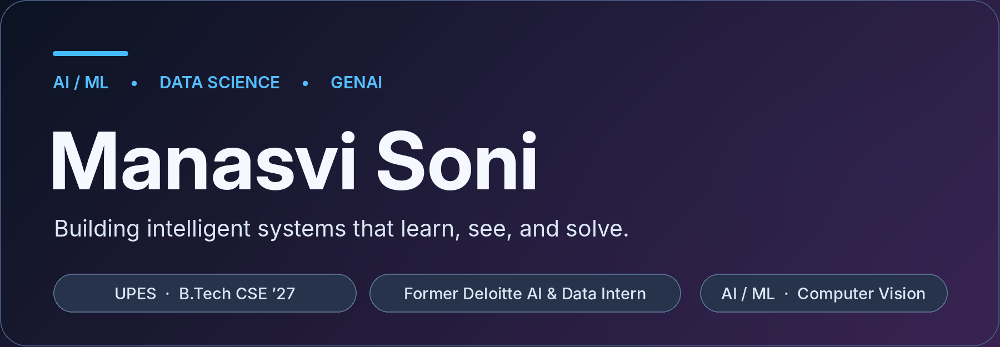
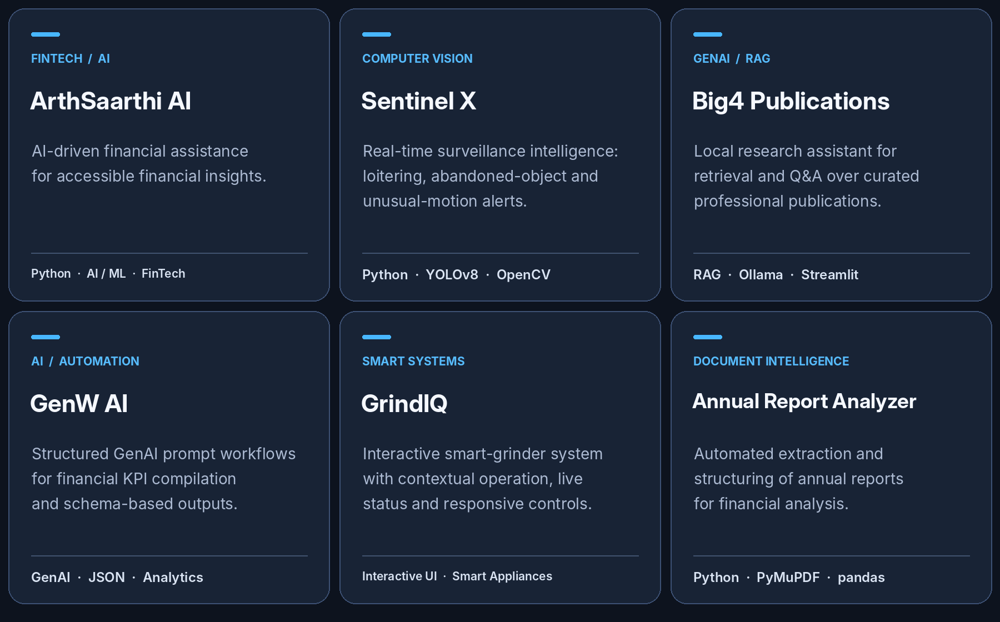

[LinkedIn](https://www.linkedin.com/in/manasvi-soni-272200290/) · [Email](mailto:manasvi354@gmail.com) · [GitHub](https://github.com/manasviisonii)

## About

I'm **Manasvi Soni**, a Computer Science undergraduate specializing in **Data Science at UPES**, and a former **AI & Data Analytics Intern at Deloitte India**.

I develop applied solutions across **machine learning, generative AI, computer vision, and intelligent automation**, turning complex ideas into thoughtful, practical systems.

## Featured work

## Experience

| Organization | Role | Focus |
|:--|:--|:--|
| **Deloitte India** | AI & Data Analytics Intern | Python automation, document analysis, RAG research, and GenAI workflows. |
| **Volted PC** | Web Developer Intern | Improved site performance through image and asset optimization. |
| **Hypervision, UPES** | Vice President | Student leadership, event planning, communication, and team coordination. |

## Toolbox

| Area | Technologies |
|:--|:--|
| **AI & Machine Learning** | LLMs · RAG · YOLOv8 · TensorFlow · Keras · scikit-learn |
| **Languages** | Python · Java · SQL · C |
| **Data & Analytics** | Pandas · NumPy · Matplotlib · Seaborn · Power BI · Tableau · openpyxl |
| **Backend & Apps** | Flask · REST APIs · Streamlit · React (learning) |
| **Databases** | MySQL · MongoDB |
| **Developer Tools** | Git · GitHub · Linux CLI · VS Code · OpenCV · PyMuPDF |

## Beyond the code

**Vice President — Hypervision, UPES** · Leading initiatives through teamwork, creativity, and communication.

**International Netball Runner-up** · National-level basketball, handball, and tchoukball player.

---

### Let's connect

[LinkedIn](https://www.linkedin.com/in/manasvi-soni-272200290/) · [Email](mailto:manasvi354@gmail.com) · [GitHub](https://github.com/manasviisonii)

Build thoughtfully. Keep learning.

