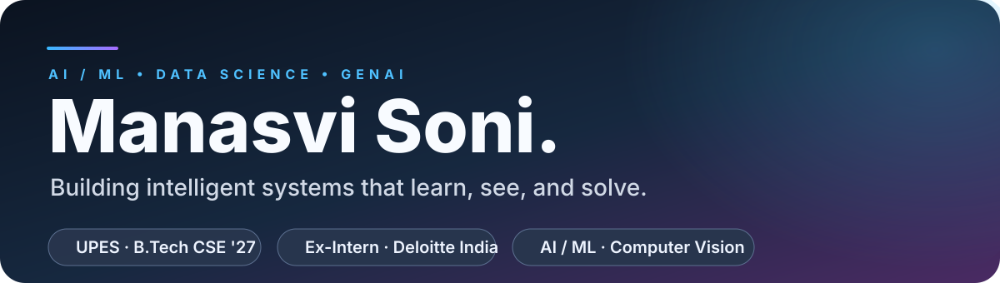

  <a href="https://www.linkedin.com/in/manasvi-soni-272200290/">LinkedIn</a> ·
  <a href="mailto:manasvi354@gmail.com">Email</a> ·
  <a href="https://github.com/manasviisonii">GitHub</a>

## About

I'm **Manasvi Soni** — a **Computer Science (Data Science)** undergraduate at **UPES** and a former **AI & Data Analytics Intern at Deloitte India**.

I build practical systems across **machine learning, GenAI, computer vision, and automation** — with a focus on turning ambitious ideas into clear, usable, and intelligent products.

## Featured work

<table>
  <tr>
    <td width="33%"></td>
    <td width="33%"></td>
    <td width="33%"></td>
  </tr>
  <tr>
    <td></td>
    <td></td>
    <td></td>
  </tr>
</table>

## GitHub snapshot

  
  

  

## Experience

| Organization | Role | Focus |
|:--|:--|:--|
| **Deloitte India** | AI & Data Analytics Intern | Python automation, financial-document analysis, local RAG research assistant, GenAI workflows, and analytics deliverables. |
| **Volted PC** | Web Developer Intern | Optimized website images and page assets to improve loading and responsiveness. |
| **Hypervision, UPES** | Vice President | Student leadership, event execution, communication, and coordination across teams. |

## Toolbox

| Area | Technologies & tools |
|:--|:--|
| **AI & Machine Learning** | Machine Learning · LLMs · RAG · Prompt Engineering · YOLOv8 · TensorFlow · Keras · scikit-learn |
| **Languages & fundamentals** | Python · Java · SQL · C · DSA · OOP · DBMS |
| **Data & analytics** | pandas · NumPy · Matplotlib · Seaborn · Power BI · Tableau · openpyxl |
| **Backend & apps** | Flask · REST APIs · Streamlit · React |
| **Databases** | MySQL · MongoDB |
| **Developer tools** | Git · GitHub · Linux CLI · VS Code · OpenCV · PyMuPDF |

## Beyond the code

**Vice President — Hypervision, UPES** · Bringing together creativity, collaboration, and student leadership.

**International Netball Runner-up** · Also represented at national level in basketball, handball, and tchoukball.

---

### Let's connect

[LinkedIn](https://www.linkedin.com/in/manasvi-soni-272200290/) · [Email](mailto:manasvi354@gmail.com) · [GitHub](https://github.com/manasviisonii)

Build. Learn. Evolve.

