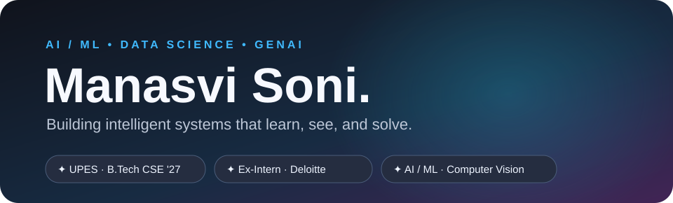

  <a href="https://www.linkedin.com/in/manasvi-soni-272200290/">LinkedIn</a> ·
  <a href="mailto:manasvi354@gmail.com">Email</a> ·
  <a href="https://github.com/manasviisonii">GitHub</a>

### About

I'm **Manasvi Soni** — a Computer Science undergraduate specializing in **Data Science at UPES (2027)** and a former **AI & Data Analytics Intern at Deloitte India**.

I design and build practical systems across **machine learning, GenAI, computer vision, and automation** — from intelligent monitoring and retrieval-based assistants to interactive product experiences. I focus on turning complex ideas into clear, usable solutions.

Curious by nature. Driven by impact. Always building.

### Now

- **Building:** Sentinel X — AI-powered surveillance, event detection, and alert visualizations.
- **Building:** GrindIQ — an interactive smart-grinder system with controls, status feedback, and a product-focused experience.
- **Exploring:** LLMs, RAG, agentic AI workflows, and practical ML systems.
- **Strengthening:** Java DSA, Python, SQL, backend fundamentals, and deployment.

### Featured work

A selection of six projects spanning AI, intelligent automation, computer vision, and data.

<table>
  <tr>
    <td width="33%"></td>
    <td width="33%"></td>
    <td width="33%"></td>
  </tr>
  <tr>
    <td></td>
    <td></td>
    <td></td>
  </tr>
</table>

Project details reflect work developed or demonstrated; source code and private internship materials are not included here. Public repository links will be added as available.

### Experience

| Organization | Role | Focus |
|:--|:--|:--|
| **Deloitte India** · Jun–Jul 2026 | AI & Data Analytics Intern | Python automation, financial-document analysis, local RAG research assistant, GenAI workflows, and analytics deliverables. |
| **Volted PC** | Web Developer Intern | Optimized website images and page assets to improve loading and responsiveness. |
| **ARISE NGO** · Jun–Jul 2024 | Social Media Intern | Digital content, campaigns, and community outreach communications. |
| **Hypervision, UPES** | Vice President | Student leadership, event execution, communication, and coordination across teams. |

### Toolbox

| Area | Technologies & tools |
|:--|:--|
| **AI & Machine Learning** | Machine Learning · LLMs · RAG · Prompt Engineering · YOLOv8 · TensorFlow · Keras · scikit-learn |
| **Languages & fundamentals** | Python · Java · SQL · C · DSA · OOP · DBMS |
| **Data & analytics** | pandas · NumPy · Matplotlib · Seaborn · Power BI · Tableau · openpyxl |
| **Backend & apps** | Flask · REST APIs · Streamlit · React (learning) |
| **Databases** | MySQL · MongoDB |
| **Developer tools** | Git · GitHub · Linux CLI · VS Code · OpenCV · PyMuPDF |

### Beyond the code

**Vice President — Hypervision, UPES** · Bringing together creativity, collaboration, and student leadership.

**International Netball Runner-up** · Also represented at national level in basketball, handball, and tchoukball.

### Problem solving & continuous learning

**Languages:** Java · Python · SQL  
**Currently strengthening:** Data structures & algorithms, clean coding, backend fundamentals, and applied machine learning.  
**Practice focus:** Arrays · Strings · Hashing · Two pointers · Sliding window · Trees

I document my projects and experiments here, and continue improving implementation quality through hands-on practice.

---

### Let's connect

**Interested in AI, data, engineering, or an idea worth building together?**

[LinkedIn](https://www.linkedin.com/in/manasvi-soni-272200290/) · [Email](mailto:manasvi354@gmail.com) · [GitHub](https://github.com/manasviisonii)

Build. Experiment. Learn. Improve.

